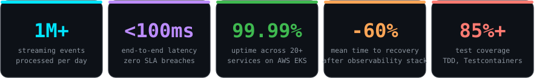
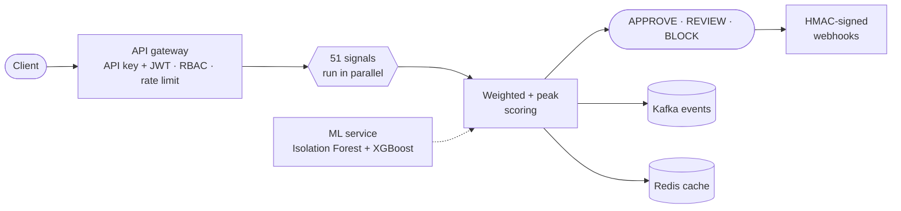
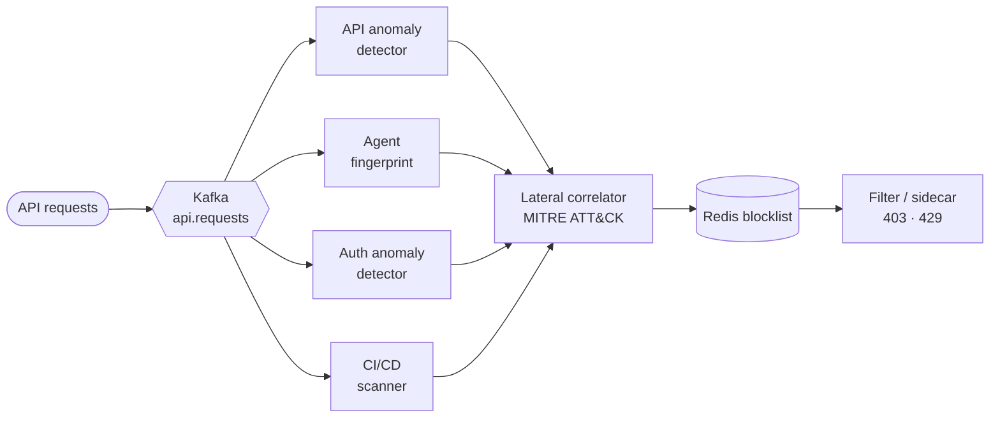
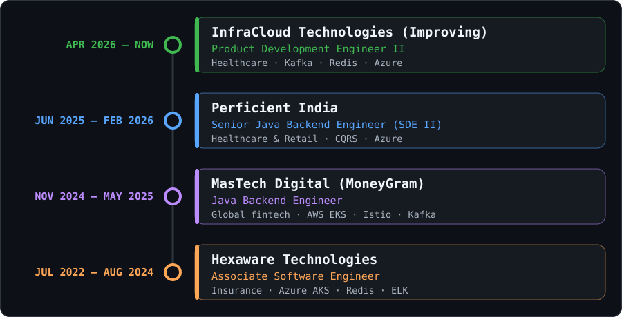

 

Backend engineer with **4 years** of experience building scalable, high-performance **RESTful microservices** in **Java and Spring Boot** on **AWS and Azure**, for **fintech and healthcare** platforms.

- ⚡ Strongest in **event-driven architecture (Kafka)**, SQL and NoSQL data stores, observability and cloud patterns
- 🧪 Quality-minded: **TDD at 85%+ coverage**, thorough code reviews, docs, runbooks and mentoring
- 🚀 I **designed, built and run a live multi-tenant SaaS, [TrustDeck](https://trustdeck.in)**, end to end
- 🏆 Winner of two hackathons, including a real-time fraud-detection system built in under 24 hours

**Languages & frameworks** 

**Messaging & data** 

**Cloud & DevOps** 

**Observability & testing** 

**Architecture & security** 
`Event-driven` `CQRS / Event Sourcing` `DDD` `12-factor` `Resilience4j` `Caching` `DLQ` `OAuth2 / JWT` `mTLS` `RBAC` `API gateways`

### 🛡️ [TrustDeck](https://github.com/Gorakhnath-R-Patil/TrustDeckEngine) · live multi-tenant fraud-detection SaaS

Built for Indian fintech startups and B2B SaaS. Every transaction runs through **51 fraud signals in parallel**, and the API returns an **APPROVE / REVIEW / BLOCK** decision in milliseconds. Weighted-plus-peak scoring stops one strong signal being diluted by many weak ones.

- 🏢 **Multi-tenancy end to end:** per-tenant rules engine, plan-based usage enforcement, Flyway-managed migrations
- 🛟 **Reliability:** Redis result caching, circuit-breaker SDKs (Java, Node.js, Python), ML microservice with fallback
- 📟 **Ops:** Prometheus alerts on error rate, p99 latency, DB pool and JVM heap
- 🧪 **Testing:** 57-test end-to-end suite, plus load / soak / spike harness and precision / recall reporting

---

### 🐆 [Lynx](https://github.com/Gorakhnath-R-Patil/Lynx) · stop AI agents abusing your APIs

Autonomous AI agents can probe APIs, brute-force OAuth and inject malicious code into PRs at machine speed, and WAFs and SIEMs often miss them. Lynx detects and blocks them in real time.

- 🧠 **6 event-driven Spring Boot services:** behavioural anomaly detection, agent fingerprinting, auth-abuse scoring and campaign correlation
- ⚡ **O(1) hot path:** servlet filter or Kubernetes sidecar plus a Redis blocklist, with no model inference per request
- 🔌 **Integrations:** Kong, NGINX, Envoy, AWS Lambda authorizer, Azure APIM, GCP Cloud Run
- 🧪 **260+ tests** (unit + Testcontainers), DLQ topics with replay API, Helm + HPA, k6 load tests against a p95 < 100 ms target

---

### 📈 [FinEx (HFT)](https://github.com/Gorakhnath-R-Patil/HFT) · trading-infrastructure simulation

Pairs **FinTech correctness** (pre-trade risk checks, double-entry ledger, clearing and settlement) with **performance engineering** (matching engine, order book, binary protocol, event log). A Spring Boot control plane is kept separate from a low-allocation trading plane, tuned through **13 evidence-driven optimization experiments**.

---

### 🔬 Systems & more builds

| | Project | What it does | Stack |
|:-:|---|---|---|
| 🐝 | [**Pulse**](https://github.com/Gorakhnath-R-Patil/Pulse) *(in progress)* | eBPF observability: traces, dependency graphs and metrics for services that were never instrumented | `Go` `eBPF` `gRPC` `ClickHouse` |
| 🕸️ | [**EdgeMesh**](https://github.com/Gorakhnath-R-Patil/EdgeMesh) *(in progress)* | Service mesh that routes on live endpoint health, not static weights | `Go` `gRPC` `Protobuf` |
| 🗂️ | [**Zara**](https://github.com/Gorakhnath-R-Patil/Zara) *(in progress)* | Local-first AI-assisted file manager for Windows: deterministic search and dedup, with a local LLM only translating queries | `C#` `.NET 9` `SQLite` `gRPC` `Ollama` |
| 🤖 | [**Project-V**](https://github.com/Gorakhnath-R-Patil/Project-V) | Fully local voice AI agent for Windows. No cloud, no API cost | `Python` `Ollama` `Whisper` `Playwright` |
| 🔗 | [**URL Shortener**](https://github.com/Gorakhnath-R-Patil/-URL-Shortener) | Idempotent shortener with redirects and top-domain metrics | `Java 17` `Spring Boot` `Docker` |
| 🎯 | [**GFocus**](https://github.com/Gorakhnath-R-Patil/GFocus) | Privacy-first Android launcher that blocks everything except chosen apps | `Kotlin` `Android` |

<b>🟢 InfraCloud Technologies (Improving)</b> · Product Development Engineer II · <i>Apr 2026 – Present</i>

 

- Modernizing a healthcare enrollment and billing platform: re-architecting legacy **TIBCO ESB** batch integrations into **event-driven Spring Boot 3 microservices on Confluent Cloud Kafka**
- Built `batch-report-service`, using **Redis atomic counters** to replace batch reconciliation with near real-time reporting
- Designed consumer reliability: DLQ handling, Redis TTL strategy and PostgreSQL-backed reconciliation through the cutover
- Diagnosed and fixed a Java 25 / Gradle toolchain incompatibility that was breaking CI across shared libraries

`Java 17/25` `Spring Boot 3` `Kafka` `Redis` `PostgreSQL` `Azure`

<b>🔵 Perficient India</b> · Senior Java Backend Engineer (SDE II) · <i>Jun 2025 – Feb 2026</i>

 

- Designed cloud-native microservices processing **1M+ streaming events/day at sub-100 ms**, with zero SLA breaches
- Architected **CQRS** fraud-detection and settlement pipelines, removing manual intervention in **95%** of exception cases
- Secured APIs with OAuth2/JWT and Azure API Management (RBAC, rate limiting); zero security incidents
- Cut release cycle time by **45%** with Azure DevOps + GitHub Actions and feature-flag zero-downtime rollouts
- Enforced TDD at **85%+ coverage** and introduced Testcontainers for Kafka-backed services

`Spring Boot 3` `Kafka` `Redis` `Azure`

<b>🟣 MasTech Digital (client: MoneyGram International)</b> · Java Backend Engineer · <i>Nov 2024 – May 2025</i>

 

- Architected and deployed **20+ Spring Boot microservices on AWS EKS with Istio**, sustaining **99.99% uptime** for 1M+ monthly transactions across 200+ countries
- Led a **Java EE monolith → microservices** migration: API latency **-35%**, infra cost **-30%**, tech debt **-50%**
- Designed Kafka **CQRS / Event Sourcing** pipelines: under 100 ms end-to-end, reconciliation time **-40%**, fraud false positives **-25%**
- Built the Prometheus / Grafana / Jaeger stack, cutting **MTTR by 60%**; met **PCI-DSS** with OAuth2/JWT, mTLS and gateway policies, zero violations
- Raised peak throughput by 30% with `ExecutorService` and `CompletableFuture`

`AWS EKS` `Istio` `Kafka` `Spring Boot` `PCI-DSS`

<b>🟠 Hexaware Technologies</b> · Associate Software Engineer · <i>Jul 2022 – Aug 2024</i>

 

- Built Spring Boot and Azure Functions services for **5M+ users** on multi-region Azure AKS at 99.9% availability
- Applied **Resilience4j** circuit breakers to REST/SOAP APIs: peak-load errors **-30%**, no cascading failures
- Designed Redis + CDN caching layers: database load **-45%**, API throughput **+50%**
- Led ELK observability integration, cutting incident detection-to-resolution time by 40%
- Mentored 2 junior engineers; both were promoted within 12 months

`Spring Boot` `Azure AKS` `Azure Functions` `Redis` `ELK`

| | |
|---|---|
| 🎓 **B.Tech, Electronics & Telecommunication** | Bharati Vidyapeeth University, Kolhapur · CGPA **8.99 / 10** · 2019 – 2022 |
| ☁️ **Azure Developer Associate (AZ-204)** | Microsoft Certified |
| ☸️ **Kubernetes & Containers Essentials** | IBM Certified |
| 🏆 **Hexaware Hackathon 2023, winner** | AI-integrated real-time fraud-detection system built in under 24 hours |
| 🥇 **Bharati Vidyapeeth Hackathon 2019, winner** | Ranked #1 of 200+ teams |
| 🎤 **Tech talks** | 3 internal system-design workshops (microservices, Kafka, distributed systems) for 15+ engineers |

Open to **backend / platform engineering** roles across India, remote friendly.

